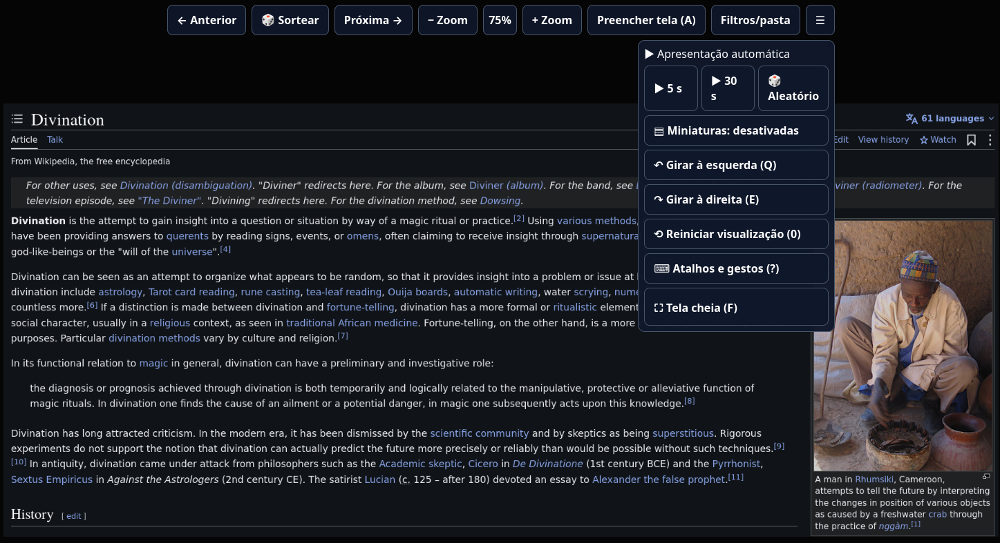

# Photo Viewer with Randomizer 🎲🔎

A local, browser-based photo viewer for exploring large image collections sequentially, folder by folder, or through randomized discovery.

> Vibe-coded with Microsoft Copilot in 2026, then manually tested and superficially reviewed.  
> Tested on Firefox Flatpak and Chrome for Android.

## ✨ Features

- 📁 Local folder access without uploading photos
- 🔎 Filename and directory-path filters
- ➡️ Sequential, folder-based, or random navigation
- 🎲 Random slideshow with 5-second or 30-second intervals
- 🔍 Zoom, drag, rotation, thumbnails, and fullscreen
- 🖱️ Keyboard, mouse, numpad, and touch gestures
- 🇺🇸 English interface with a 🇧🇷 Portuguese option
- 🛡️ Ignores RAW, SVG, unsupported files, and images over 50 MB

## ⚠️ Notes

This is an experimental personal project, not a professionally audited application. No pull requests or issues are going to be acepted, as it's a finished work. Browser support for formats such as HEIC, JPEG XL, TIFF, and JPEG 2000 varies. Android support remains experimental and may depend on the device, browser, file picker, and accessibility settings.

## 🚀 Quick Usage

- **Firefox Flatpak:** download the HTML file and check the hamburger menu for the complete shortcut list.
- **Folder permissions:** allow access to the required folders and drives. For external drives under Firefox Flatpak, use Flatseal to grant filesystem access when necessary.
- **Android:** download the HTML file and open it with Chrome.

## 🎲 Randomness as a Way of Seeing

A photo collection can be followed as a path: one image after another, or one folder after another. It can also be approached as a field of chance. In folders containing thousands of photographs, many images remain effectively hidden beneath chronology, filenames, and directory structures. Random selection gives those images another opportunity to appear. It may reveal overlooked photographs, unexpected connections, or simply a surprising overview of the collection.

Although the dev is an atheist and not a fan of esoteric divination practices: arranging apparently random signs so that forgotten relationships, contrasts, and patterns may become visible. This echoes a secular interpretation of [divination](https://en.wikipedia.org/wiki/Divination): not as prediction, but as an attempt to organize what appears random so that another way of looking may emerge.

## Screenshots

